# Docker

## What is Docker
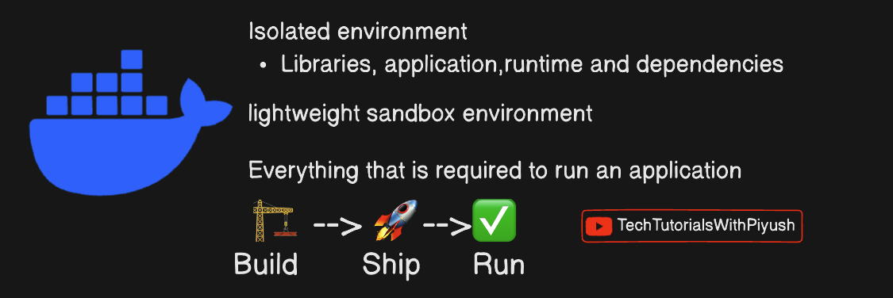

## Container vs VMs
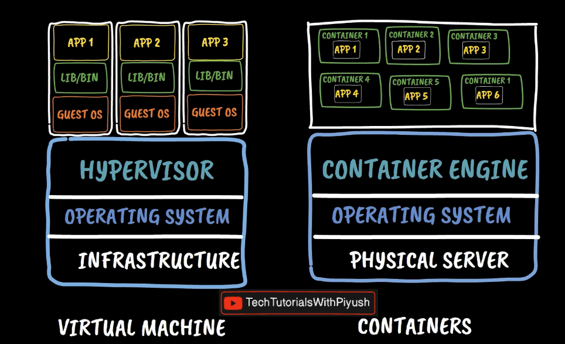

## Challenges with the non-containerized applications
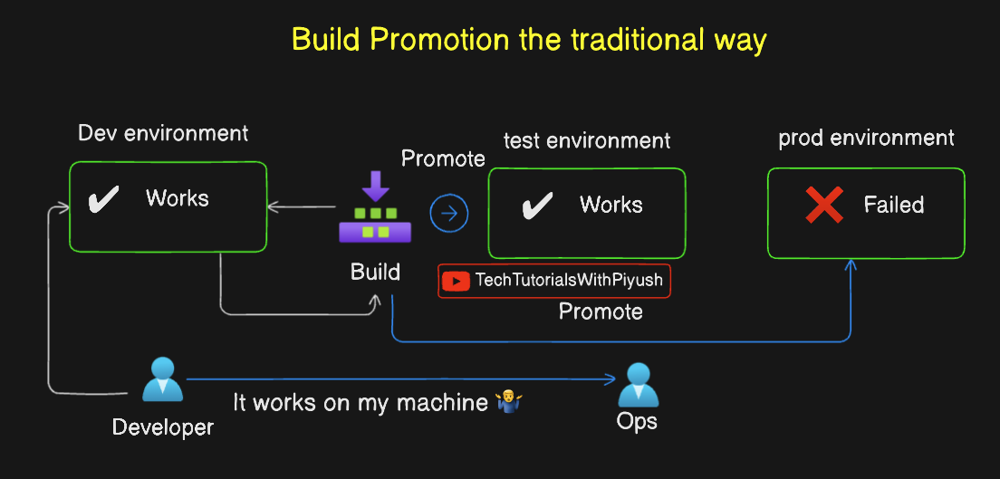

## How Docker solves the challenges
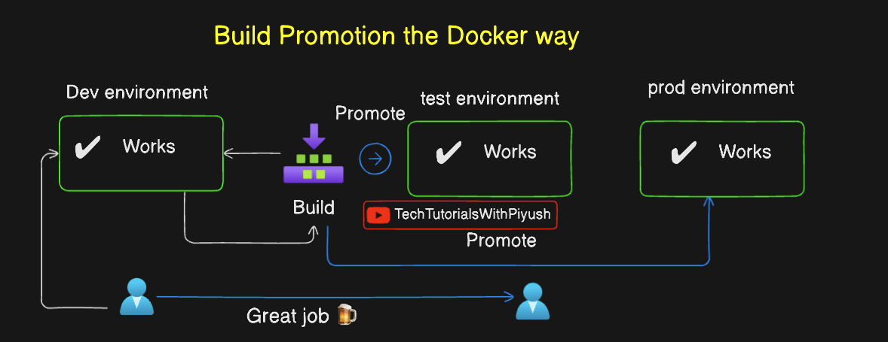

## Docker flow
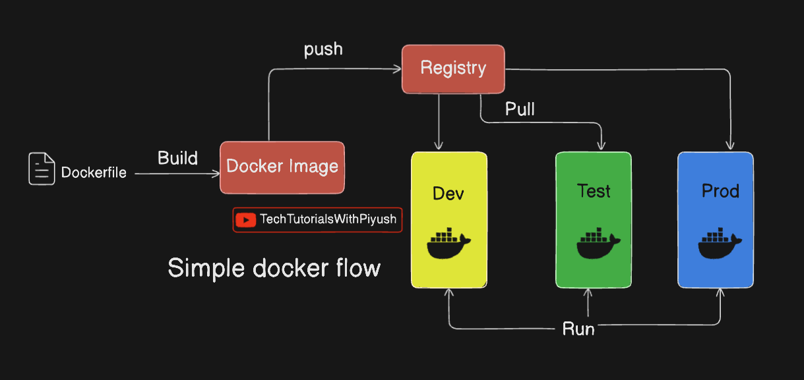

## Docker architecture
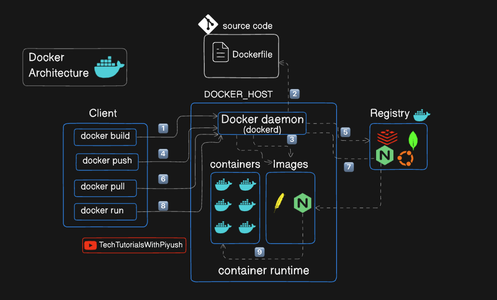

# Fundamentals of Kubernetes

## Kubernetes architecture
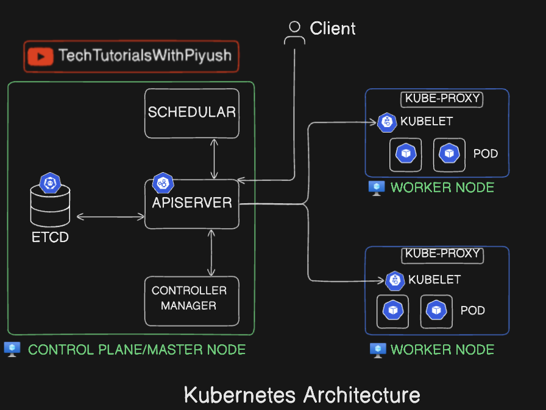

## Master/Control plane Node V/s Worker Node ( Node is nothing but a Virtual machine)
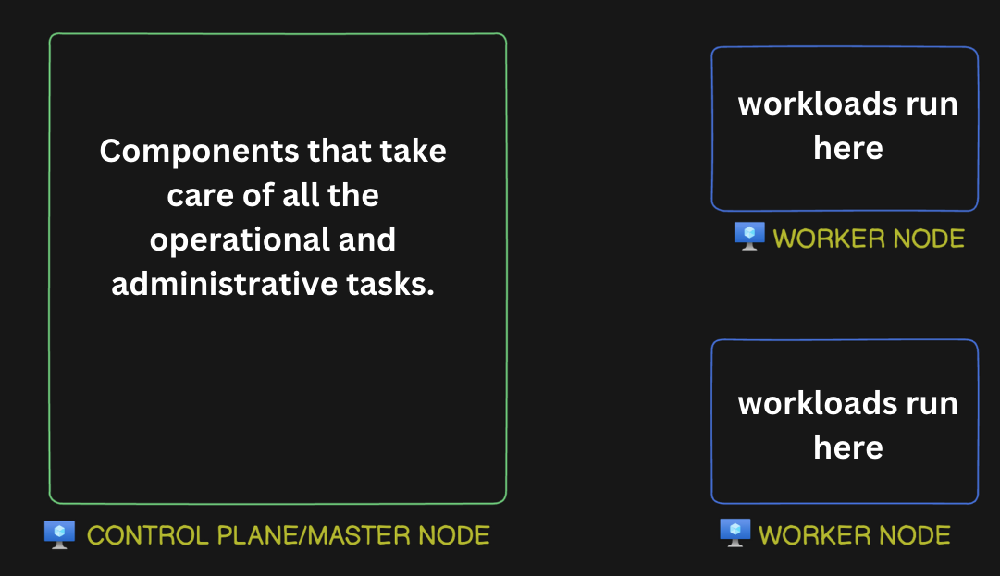

## ApiServer :- Client interacts with the cluster using ApiServer
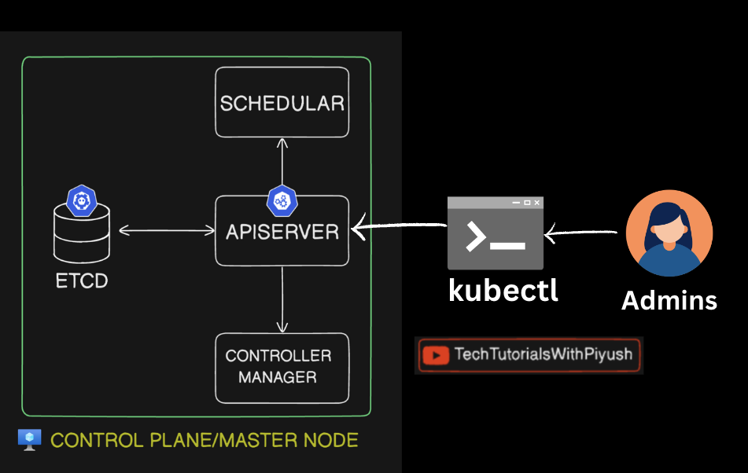

## Scheduler: decide which pod to be scheduled on which node based on different factors
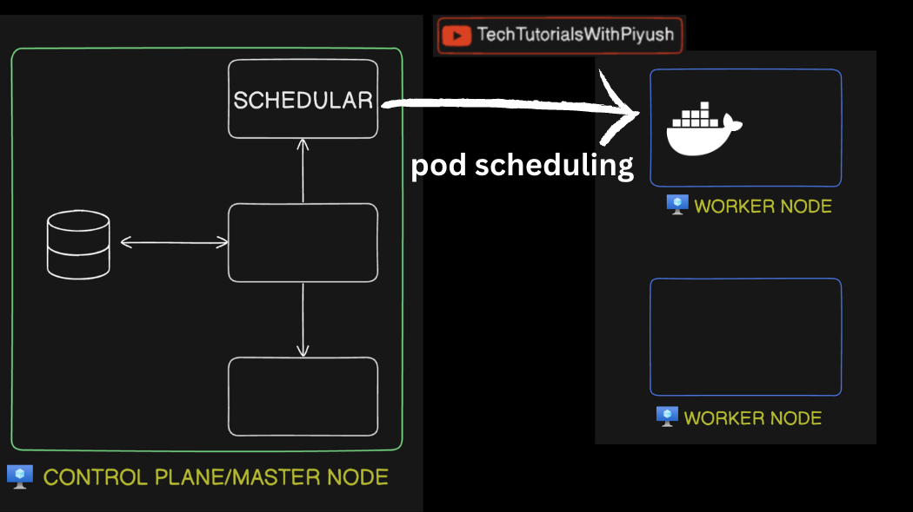

## Controller Manager
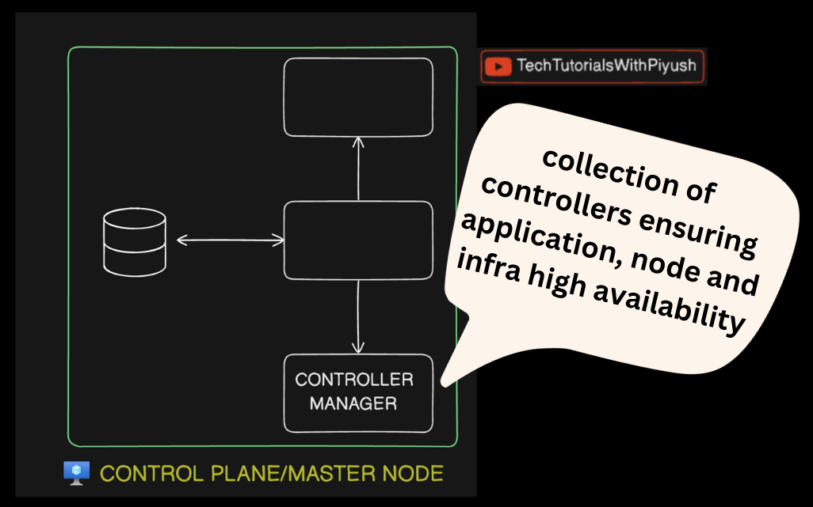

## ETCD Server - Key value database that stores the cluster state and configuration
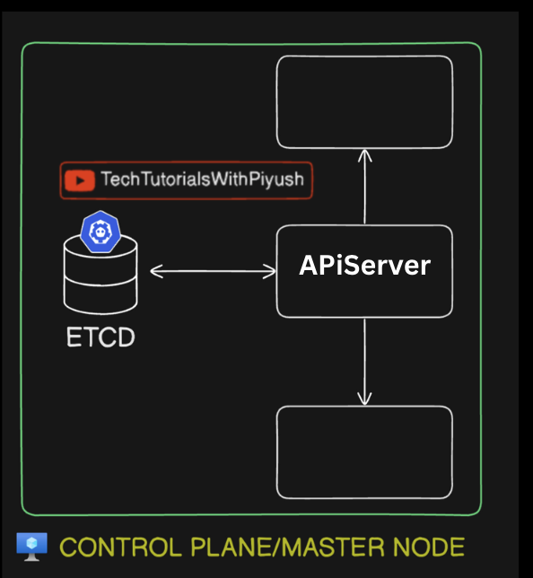

## Kubelet - Node-level agent that helps container management and receives instructions from Api server
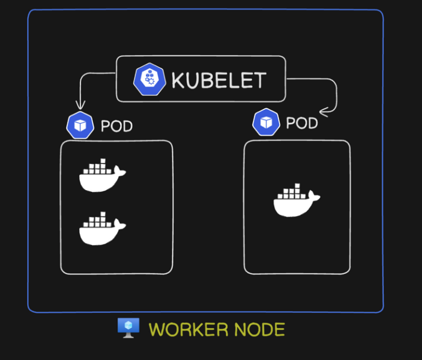

## Kube proxy - Pod to pod communication
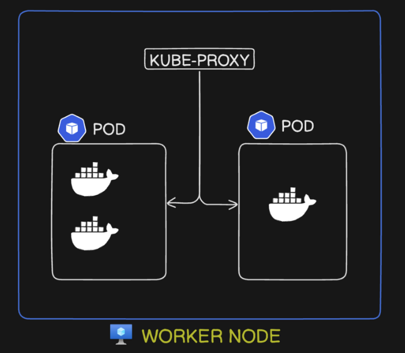


# Installation and Basic commands

https://kubernetes.io/docs/tasks/tools/

## Install kind

https://kind.sigs.k8s.io/docs/user/quick-start/#installation

```sh
[ $(uname -m) = x86_64 ] && curl -Lo ./kind https://kind.sigs.k8s.io/dl/v0.33.0/kind-linux-amd64

chmod +x ./kind

sudo mv ./kind /usr/local/bin/kind
```

### verify installation
```sh
kind version
```
```txt
kind v0.33.0 go1.26.7 linux/amd64
```

## Install kubernetes

https://kubernetes.io/docs/tasks/tools/install-kubectl-linux/

### verify installation
```sh
kubectl version
```
```txt
Client Version: v1.37.2
Kustomize Version: v5.8.1
Server Version: v1.37.0
```

## kind create cluster
Pick Image from https://github.com/kubernetes-sigs/kind/releases

```sh
kind create cluster --image kindest/node:v1.37.0@sha256:a1ed56cfb0e7b93589bdf97c8cd566405a265939e3620fc4f5de89adff580ae5 --name cka-cluster1
```
```txt
Creating cluster "cka-cluster1" ...
 ✓ Ensuring node image (kindest/node:v1.37.0) 🖼️ 
 ✓ Preparing nodes 📦  
 ✓ Writing configuration 📜 
 ✓ Starting control-plane 🕹️ 
 ✓ Installing CNI 🔌 
 ✓ Installing StorageClass 💾 
Set kubectl context to "kind-cka-cluster1"
You can now use your cluster with:

kubectl cluster-info --context kind-cka-cluster1

Have a nice day! 👋
```

### Verify cluster creation
```sh
kind get clusters
```

```sh
kubectl cluster-info --context kind-cka-cluster1
```
```txt
Kubernetes control plane is running at https://127.0.0.1:44835
CoreDNS is running at https://127.0.0.1:44835/api/v1/namespaces/kube-system/services/kube-dns:dns/proxy

To further debug and diagnose cluster problems, use 'kubectl cluster-info dump'.
```

### get nodes
```sh
kubectl get nodes
```
```txt
NAME                         STATUS   ROLES           AGE     VERSION
cka-cluster1-control-plane   Ready    control-plane   8m48s   v1.37.0
```

### multi node cluster createion
```sh
kind create cluster --image kindest/node:v1.37.0@sha256:a1ed56cfb0e7b93589bdf97c8cd566405a265939e3620fc4f5de89adff580ae5 --name cka-cluster2 --config kind-example-config.yaml
```
```txt
Creating cluster "cka-cluster2" ...
 ✓ Ensuring node image (kindest/node:v1.37.0) 🖼️ 
 ✓ Preparing nodes 📦 📦 📦  
 ✓ Writing configuration 📜 
 ✓ Starting control-plane 🕹️ 
 ✓ Installing CNI 🔌 
 ✓ Installing StorageClass 💾 
 ✓ Joining worker nodes 🚜 
Set kubectl context to "kind-cka-cluster2"
You can now use your cluster with:

kubectl cluster-info --context kind-cka-cluster2

Thanks for using kind! 😊
```

#### verify cluster creation
```sh
kubectl cluster-info --context kind-cka-cluster2
```
```txt
Kubernetes control plane is running at https://127.0.0.1:38577
CoreDNS is running at https://127.0.0.1:38577/api/v1/namespaces/kube-system/services/kube-dns:dns/proxy

To further debug and diagnose cluster problems, use 'kubectl cluster-info dump'.
```

#### get nodes
```sh
kubectl get nodes
```
```txt
NAME                         STATUS   ROLES           AGE     VERSION
cka-cluster2-control-plane   Ready    control-plane   2m14s   v1.37.0
cka-cluster2-worker          Ready    <none>          119s    v1.37.0
cka-cluster2-worker2         Ready    <none>          119s    v1.37.0
```


### kubectl get context
```sh
kubectl config get-contexts
```
```txt
CURRENT   NAME                CLUSTER             AUTHINFO            NAMESPACE
          kind-cka-cluster1   kind-cka-cluster1   kind-cka-cluster1   
*         kind-cka-cluster2   kind-cka-cluster2   kind-cka-cluster2   
```

### kubectl context switching
```sh
kubectl config use-context kind-cka-cluster1
```

### kubectl deleteing cluster
```sh
kind delete cluster --name kind-cka-cluster1
```

### kubectl running pod
```sh
kubectl run nginx-pod --image=nginx:latest
```

#### Verify pod status
```sh
kubectl get pods
```
```txt
NAME        READY   STATUS              RESTARTS   AGE
nginx-pod   0/1     ContainerCreating   0          7s
```


## Kubectl Cheatsheet
https://kubernetes.io/docs/reference/kubectl/quick-reference/


### get pods
```sh
kubectl get pods
```

### get services
```sh
kubectl get services
```

### get deployment
```sh
kubectl get deployment
```

### get replicase
```sh
kubectl get replicaset
```
### kubectl delete pods
```sh
kubectl delete pods nginx-pod
```

# YAML Introduction

## 1. What is YAML?

YAML stands for **YAML Ain't Markup Language**.

It is a human-readable data serialization format used to store and exchange configuration data.

YAML is commonly used in:
- Kubernetes configuration files
- Docker Compose
- Ansible
- CI/CD pipelines (GitHub Actions, GitLab CI)
- Application configuration

**File extensions:**
- `.yaml`
- `.yml`

Both extensions are equivalent.

## 2. Basic YAML Syntax

YAML uses indentation to represent structure.

```yaml
name: nginx
version: "1.0"
active: true
```

Key-value pairs follow this syntax:

```yaml
key: value
```

**Important rules:**
- Use spaces for indentation, not tabs.
- Indentation defines the structure.
- YAML is case-sensitive.
- Use a colon (`:`) to separate keys and values.
- Use `#` for comments.

## 3. Data Types

YAML supports several basic data types.

### String

```yaml
name: nginx
message: "Hello World"
description: 'Web Server'
```

### Integer

```yaml
age: 27
port: 8080
```

### Float

```yaml
price: 99.99
version: 1.5
```

### Boolean

```yaml
active: true
enabled: false
```

### Null

```yaml
value: null
username: ~
```

## 4. Lists / Arrays

Lists are represented using a hyphen (`-`).

```yaml
fruits:
  - apple
  - banana
  - mango
```

Another way to represent a list:

```yaml
fruits: [apple, banana, mango]
```

## 5. Nested Objects / Dictionaries

Use indentation to define nested structures.

```yaml
employee:
  name: Jay
  age: 27
  address:
    city: Kanpur
    state: Uttar Pradesh
    country: India
```

## 6. List of Objects

```yaml
employees:
  - name: Jay
    role: Backend Developer
    age: 27

  - name: Rahul
    role: Frontend Developer
    age: 25
```

## 7. Comments

Comments start with `#`.

```yaml
# Application configuration
app:
  name: my-app
  port: 8080  # Application port
```

## 8. Multiline Strings

### Literal Block (`|`)

Preserves line breaks.

```yaml
description: |
  This is a YAML example.
  It contains multiple lines.
  Line breaks are preserved.
```

### Folded Block (`>`)

Folds most line breaks into spaces.

```yaml
description: >
  This is a YAML example.
  It contains multiple lines.
  But it will be treated as one paragraph.
```

## 9. YAML Anchors and Aliases

Anchors (`&`) define reusable values, while aliases (`*`) reuse them.

```yaml
defaults: &default_config
  image: nginx:latest
  restart: always

service1:
  <<: *default_config
  port: 8080

service2:
  <<: *default_config
  port: 8081
```

## 10. Practical Example: Kubernetes YAML

Kubernetes uses YAML files to define resources such as Pods, Deployments, and Services.

### nginx-pod.yaml

```yaml
apiVersion: v1
kind: Pod
metadata:
  name: nginx-pod
  labels:
    app: nginx

spec:
  containers:
    - name: nginx
      image: nginx:latest
      ports:
        - containerPort: 80
```

### Understanding the fields

| Field | Description |
|---|---|
| `apiVersion` | Kubernetes API version |
| `kind` | Type of Kubernetes resource |
| `metadata` | Resource information |
| `name` | Resource name |
| `labels` | Key-value metadata |
| `spec` | Desired resource configuration |
| `containers` | List of containers |
| `image` | Container image |
| `ports` | Container port configuration |

Apply the YAML file:

```bash
kubectl apply -f nginx-pod.yaml
```

Check the Pod:

```bash
kubectl get pods
```

Delete the Pod:

```bash
kubectl delete -f nginx-pod.yaml
```

## 11. Common YAML Mistakes

### Incorrect indentation

```yaml
employee:
 name: Jay
  age: 27
```

Correct:

```yaml
employee:
  name: Jay
  age: 27
```

### Using tabs

YAML does not allow tabs for indentation. Use spaces.

### Missing quotes for ambiguous strings

Some values can be interpreted as booleans, numbers, or other types.

```yaml
version: "1.0"
status: "on"
```

### Incorrect list formatting

Incorrect:

```yaml
fruits:
- apple
  - banana
```

Correct:

```yaml
fruits:
  - apple
  - banana
```

## 12. Useful YAML Tools

- YAML Validator: https://www.yamllint.com/
- YAML Specification: https://yaml.org/spec/
- Kubernetes Documentation: https://kubernetes.io/docs/concepts/overview/working-with-objects/

## 13. Quick Revision

| Concept | Syntax |
|---|---|
| Key-value | `name: nginx` |
| List | `- apple` |
| Object | `employee: name: Jay` (nested using indentation) |
| Comment | `# comment` |
| String | `name: "Jay"` |
| Boolean | `active: true` |
| Null | `value: null` |
| Multiline | `description: |` |
| Anchor | `&name` |
| Alias | `*name` |

**Key Takeaway:** YAML is a human-readable configuration format. Understanding indentation, key-value pairs, lists, and nested objects is essential before working with Kubernetes manifests.

# Kubectl Pod Creation

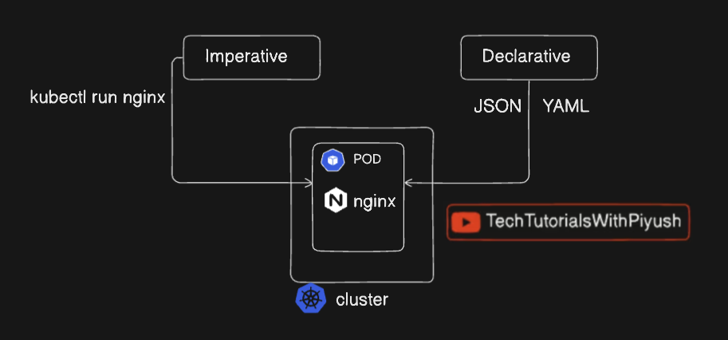


## Creating an nginx pod through kubectl imperative way
```sh
kubectl run nginx-pod --image=nginx:latest
```

## Creating an nginx pod through kubectl declarative way

### create `pod.yaml`
```yaml
# This is a sample pod yaml

apiVersion: v1
kind: Pod
metadata:
  name: nginx-pod
  labels:
    env: demo
    type: frontend
spec:
  containers:
  - name: nginx-container
    image: nginx
    ports:
    - containerPort: 80
```
** In `metadata` we have `labels` it is basically a key-value pair, whihc can be used to identify/filter.

### create pod
```sh
kubectl create -f pod.yaml
``` 

#### verification
```sh
kubectl get pods
```
```txt
NAME        READY   STATUS    RESTARTS   AGE
nginx-pod   1/1     Running   0          5s
```

### applying new yaml
```sh
kubectl apply -f pod.yaml
```

### describing pod
```sh
kubectl describe pod nginx-pod
```

### edit pod yaml
```sh
kubectl edit pod nginx-pod
```

### get a yaml template for any image
```sh
kubectl run nginx --image=nginx --dry-run=client -o yaml
```
```yaml
apiVersion: v1
kind: Pod
metadata:
  labels:
    run: nginx
  name: nginx
spec:
  containers:
  - image: nginx
    name: nginx
    resources: {}
  dnsPolicy: ClusterFirst
  restartPolicy: Always
status: {}
```


# Kubectl replication

## ReplicationController

### create `rc.yaml` and  use below content
```sh
touch rc.yaml
```
```yaml
apiVersion: v1
kind: ReplicationController
metadata:
  name: nginx-rc
  labels:
    env: demo
spec:
  replicas: 3
  template:
    metadata:
      labels:
        env: demo
    spec:
      containers:
        - name: nginx
          image: nginx
          ports:
            - containerPort: 80
```

#### apply it
```sh
kubectl apply -f rc.yaml 
```

#### verify it
```sh
kubectl get pods
```
```txt
NAME             READY   STATUS    RESTARTS   AGE
nginx-rc-2mjzb   1/1     Running   0          7s
nginx-rc-bspjw   1/1     Running   0          7s
nginx-rc-wq4p7   1/1     Running   0          7s
```

## ReplicaSet

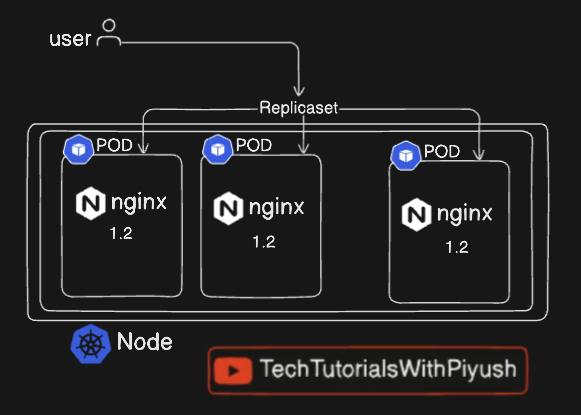

### create `rs.yaml` and use below content
```sh
touch rs.yaml
```
```yaml
apiVersion: apps/v1
kind: ReplicaSet
metadata:
  name: nginx-rs
  labels:
    env: demo
spec:
  replicas: 3
  selector:
    matchLabels:
        env: demo
  template:
    metadata:
      labels:
        env: demo
    spec:
      containers:
        - name: nginx
          image: nginx
          ports:
            - containerPort: 80
```

### Apply it
```sh
kubectl apply -f rs.yaml
```

### verify if
```sh
kubectl get pods
```
```txt
NAME             READY   STATUS    RESTARTS   AGE
nginx-rc-6l5zs   1/1     Running   0          81s
nginx-rc-sz8ps   1/1     Running   0          81s
nginx-rc-vjj9m   1/1     Running   0          81s
nginx-rs-f8svq   1/1     Running   0          7s
nginx-rs-fnqkt   1/1     Running   0          7s
nginx-rs-ktcvg   1/1     Running   0          7s
```

## Updating replicas

### Using kubectl apply
** edit the <yaml-file> and then execute below commands
```sh
kubectl apply -f <yaml-file>
```

### Using kubectl edit
```sh
kubectl edit rs/nginx-rs
```
** edit and save the file

### Using kubectl scale
```sh
kubectl scale --replicas=10 rs/nginx-rs
```

## Deleting ReplicaController

### Fetch the ReplicaController
```sh
kubectl get rc
```
```txt
NAME       DESIRED   CURRENT   READY   AGE
nginx-rc   3         3         3       13m
```

### Delete the ReplicaController
```sh
kubectl delete rc/nginx-rc
```
```txt
replicationcontroller "nginx-rc" deleted from default namespace
```

## Deleting ReplicaSet

### Fetch the ReplicaSet
```sh
kubectl get rs
```
```txt
NAME       DESIRED   CURRENT   READY   AGE
nginx-rs   3         3         3       14m
```

### Delete the ReplicaSet
```sh
kubectl delete rs/nginx-rs
```
```txt
replicaset.apps "nginx-rs" deleted from default namespace
```

# Difference between ReplicationController and ReplicaSet

Both ReplicationController and ReplicaSet maintain a desired number of Pod replicas. They can manage existing Pods and create new Pods when required.

The main difference is their selector capabilities:

- **ReplicationController:** Supports only equality-based selectors.
- **ReplicaSet:** Supports both equality-based and set-based selectors.

Additionally, ReplicaSet is used by Kubernetes Deployments to manage Pods.

**Example:** ReplicaSet supports operators such as `In`, `NotIn`, `Exists`, and `DoesNotExist` through `matchExpressions`.

# Kubectl deployment

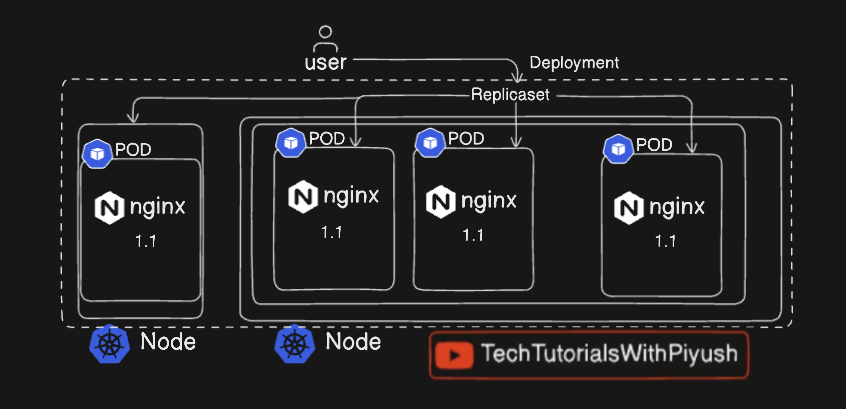

### Create the yaml file and add below content in it
```sh
touch deploy.yaml
```
```yaml
apiVersion: apps/v1
kind: Deployment
metadata:
  labels:
    app: nginx-deploy
  name: nginx-deploy
spec:
  replicas: 3
  selector:
    matchLabels:
      app: nginx-deploy
  strategy: {}
  template:
    metadata:
      labels:
        app: nginx-deploy
    spec:
      containers:
      - image: nginx
        name: nginx
        resources: {}
status: {}
```

### Kubectl apply
```sh
kubectl apply -f deploy.yaml
```
```txt
deployment.apps/nginx-deploy created
```

### verify creation
```sh
kubectl get deploy
```
```txt
NAME           READY   UP-TO-DATE   AVAILABLE   AGE
nginx-deploy   3/3     3            3           2m36s
```

```sh
kubectl get pods
```
```txt
NAME                            READY   STATUS    RESTARTS   AGE
nginx-deploy-5df7454d54-tm5dn   1/1     Running   0          101s
nginx-deploy-5df7454d54-zc2qv   1/1     Running   0          101s
nginx-deploy-5df7454d54-znnjs   1/1     Running   0          101s
```

### verify all
```sh
kubectl get all
```
```txt
NAME                                READY   STATUS    RESTARTS   AGE
pod/nginx-deploy-5df7454d54-tm5dn   1/1     Running   0          3m18s
pod/nginx-deploy-5df7454d54-zc2qv   1/1     Running   0          3m18s
pod/nginx-deploy-5df7454d54-znnjs   1/1     Running   0          3m18s

NAME                 TYPE        CLUSTER-IP   EXTERNAL-IP   PORT(S)   AGE
service/kubernetes   ClusterIP   10.96.0.1    <none>        443/TCP   140m

NAME                           READY   UP-TO-DATE   AVAILABLE   AGE
deployment.apps/nginx-deploy   3/3     3            3           3m18s

NAME                                      DESIRED   CURRENT   READY   AGE
replicaset.apps/nginx-deploy-5df7454d54   3         3         3       3m18s
```

### updating image
```sh
kunectl set image deploy/nginx-deploy nginx=nginx:1.9.1
```

### checking deploy history
```sh
kubectl rollout history deploy/nginx-deploy
```

### undo the chnage
```sh
kubectl rollout undo deploy/nginx-deploy
```

### Create Yaml template
```sh
kubectl create deploy deploy/nginx-deploy --image=nginx --dry-run=client -o yaml
```

# Kubectl services

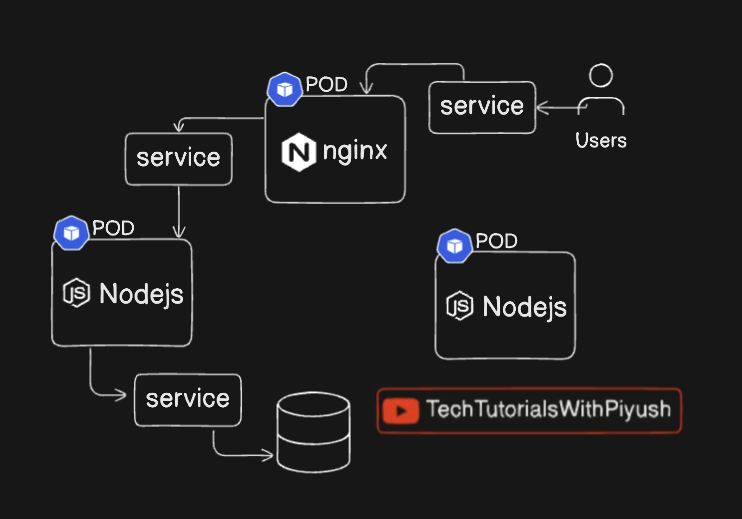

## Create cluster from yaml

### create `kind.yaml` with below content
```sh
touch kind.yaml
```
```yaml
kind: Cluster
apiVersion: kind.x-k8s.io/v1alpha4
nodes:
  - role: control-plane
    extraPortMappings:
      - containerPort: 30001
        hostPort: 30001
        protocol: TCP
  - role: worker
  - role: worker
```

### create the cluster
```sh
kind create cluster --config kind.yaml --name cka-cluster1
```

## Create deployment from yaml
```sh
touch deploy.yaml
```
```yaml
apiVersion: apps/v1
kind: Deployment
metadata:
  labels:
    app: nginx-deploy
  name: nginx-deploy
spec:
  replicas: 3
  selector:
    matchLabels:
      app: nginx-deploy
  strategy: {}
  template:
    metadata:
      labels:
        app: nginx-deploy
    spec:
      containers:
      - image: nginx
        name: nginx
        ports:
        - containerPort: 80
        resources: {}
status: {}
```

### create the deployment
```sh
kubectl apply -f deploy.yaml
```

## NodePort

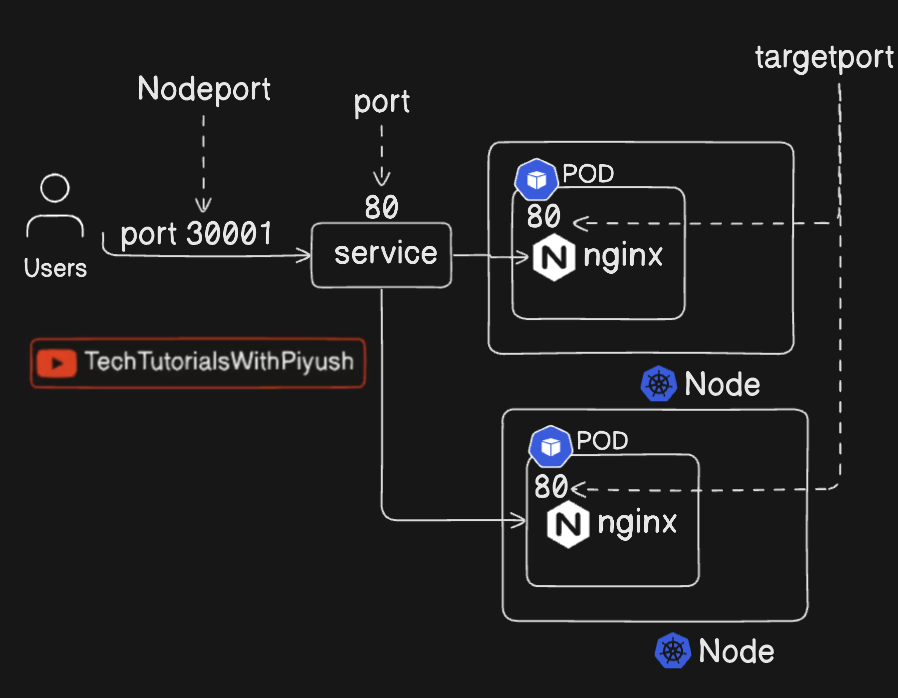

### Create `nodeport.yaml` with below content
```sh
touch nodeport.yaml
```
```yaml
apiVersion: v1
kind: Service
metadata:
  name: nodeport-svc
  labels:
    env: demo
spec:
  type: NodePort
  selector:
    app: nginx-deploy
  ports:
    - port: 80
      targetPort: 80
      nodePort: 30001
      protocol: TCP
```

### Execute belwo one
```sh
kubectl create -f nodeport.yaml
```
```txt
service/nodeport-svc created
```

### verify it
```sh
kubectl get svc
```
```txt
NAME           TYPE        CLUSTER-IP      EXTERNAL-IP   PORT(S)        AGE
kubernetes     ClusterIP   10.96.0.1       <none>        443/TCP        3h33m
nodeport-svc   NodePort    10.96.157.216   <none>        80:30001/TCP   8s
```

### verify whether it is accessible or not
```sh
curl http://localhost:30001
```
```htnl
<!DOCTYPE html>
<html>
<head>
<title>Welcome to nginx!</title>
<style>
html { color-scheme: light dark; }
body { width: 35em; margin: 0 auto;
font-family: Tahoma, Verdana, Arial, sans-serif; }
</style>
</head>
<body>
<h1>Welcome to nginx!</h1>
<p>If you see this page, nginx is successfully installed and working.
Further configuration is required for the web server, reverse proxy, 
API gateway, load balancer, content cache, or other features.</p>

<p>For online documentation and support please refer to
<a href="https://nginx.org/">nginx.org</a>.<br/>
To engage with the community please visit
<a href="https://community.nginx.org/">community.nginx.org</a>.<br/>
For enterprise grade support, professional services, additional 
security features and capabilities please refer to
<a href="https://f5.com/nginx">f5.com/nginx</a>.</p>

<p><em>Thank you for using nginx.</em></p>
</body>
</html>
```

## ClusterIP

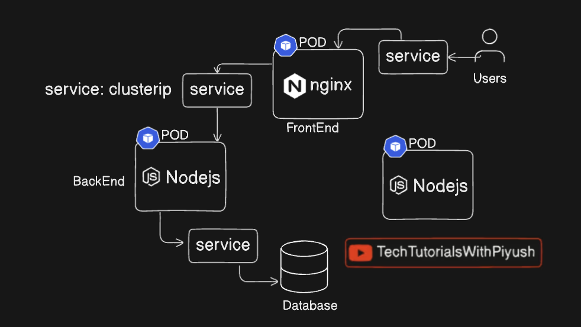

### create `clusterip.yaml` with below content
```sh
touch clusterip.yaml
```
```yaml
apiVersion: v1
kind: Service
metadata:
  name: cluster-svc
  labels:
    env: demo
spec:
  type: ClusterIP
  selector:
    app: nginx-deploy
  ports:
    - port: 80
      targetPort: 80
      protocol: TCP
```

### create the service
```sh
kubectl apply -f clusterip.yaml
```
```txt
service/cluster-svc created
```

### verify service
```sh
kubectl get svc
```
```txt
NAME           TYPE        CLUSTER-IP      EXTERNAL-IP   PORT(S)        AGE
cluster-svc    ClusterIP   10.96.108.17    <none>        80/TCP         23s
kubernetes     ClusterIP   10.96.0.1       <none>        443/TCP        11m
nodeport-svc   NodePort    10.96.165.194   <none>        80:30001/TCP   11m
```

```sh
kubectl get endpoints
```
```txt
NAME           ENDPOINTS                                   AGE
cluster-svc    10.244.2.2:80,10.244.2.3:80,10.244.2.4:80   110s
kubernetes     172.23.0.3:6443                             13m
nodeport-svc   10.244.2.2:80,10.244.2.3:80,10.244.2.4:80   12m
```

## LoadBalancer

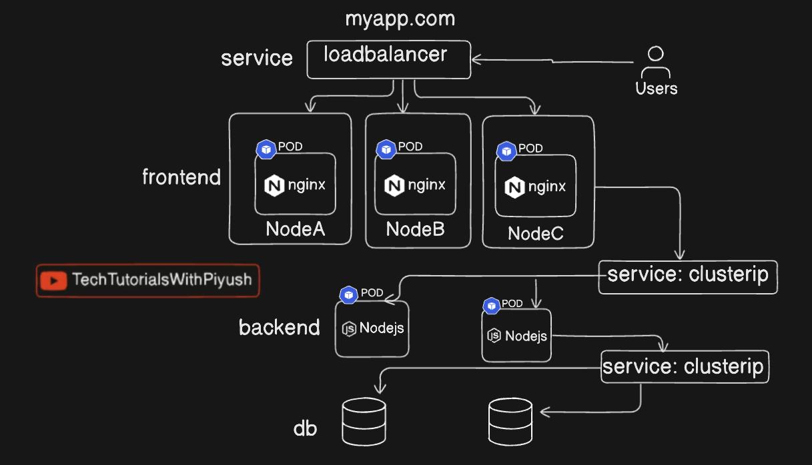

### create `lb.yaml` with below content
```sh
touch lb.yaml
```
```yaml
apiVersion: v1
kind: Service
metadata:
  name: lb-svc
  labels:
    env: demo
spec:
  type: LoadBalancer 
  selector:
    app: nginx-deploy
  ports:
    - port: 80
      targetPort: 80
      protocol: TCP
```

### create it
```sh
kubectl create -f lb.yaml
```
```txt
service/lb-svc created
```


### verify service
```sh
kubectl get svc
```
```txt
NAME           TYPE           CLUSTER-IP      EXTERNAL-IP   PORT(S)        AGE
cluster-svc    ClusterIP      10.96.108.17    <none>        80/TCP         8m32s
kubernetes     ClusterIP      10.96.0.1       <none>        443/TCP        20m
lb-svc         LoadBalancer   10.96.250.160   <pending>     80:30934/TCP   64s
nodeport-svc   NodePort       10.96.165.194   <none>        80:30001/TCP   19m
```

```sh
kubectl get endpoints
```
```txt
NAME           ENDPOINTS                                   AGE
cluster-svc    10.244.2.2:80,10.244.2.3:80,10.244.2.4:80   8m49s
kubernetes     172.23.0.3:6443                             20m
lb-svc         10.244.2.2:80,10.244.2.3:80,10.244.2.4:80   81s
nodeport-svc   10.244.2.2:80,10.244.2.3:80,10.244.2.4:80   19m
```


## ExternalName

## Create `externalname.yaml` with below content
```sh
touch externalname.yaml
```
```yaml
apiVersion: v1
kind: Service
metadata:
  name: externalname-svc
  labels:
    env: demo
spec:
  type: ExternalName 
  selector:
    app: nginx-deploy
  externalName: my.service.example.com
```


### create it
```sh
kubectl create -f externalname.yaml
```
```txt
service/externalname-svc created
```


### verify service
```sh
kubectl get svc
```
```txt
NAME               TYPE           CLUSTER-IP      EXTERNAL-IP              PORT(S)        AGE
cluster-svc        ClusterIP      10.96.108.17    <none>                   80/TCP         16m
externalname-svc   ExternalName   <none>          my.service.example.com   <none>         49s
kubernetes         ClusterIP      10.96.0.1       <none>                   443/TCP        28m
lb-svc             LoadBalancer   10.96.250.160   <pending>                80:30934/TCP   9m5s
nodeport-svc       NodePort       10.96.165.194   <none>                   80:30001/TCP   27m
```

### test it
```sh
kubectl run dns-test \
  --image=busybox:1.36 \
  --restart=Never \
  --rm -it \
  -- nslookup externalname-svc.default.svc.cluster.local
```
```txt
Server:         10.96.0.10
Address:        10.96.0.10:53

externalname-svc.default.svc.cluster.local      canonical name = my.service.example.com

externalname-svc.default.svc.cluster.local      canonical name = my.service.example.com

All commands and output from this session will be recorded in container logs, including credentials and sensitive information passed through the command prompt.
If you don't see a command prompt, try pressing enter.
warning: couldn't attach to pod/dns-test, falling back to streaming logs: Internal error occurred: Internal error occurred: error attaching to container: failed to load task: no running task found: not found
Server:         10.96.0.10
Address:        10.96.0.10:53

externalname-svc.default.svc.cluster.local      canonical name = my.service.example.com

externalname-svc.default.svc.cluster.local      canonical name = my.service.example.com

pod "dns-test" deleted from default namespace
```


## Using kubectl expose
```sh
kubectl expose deployment nginx-deploy --port=80 --target-port=80
```
```txt
service/nginx-deploy exposed
```

### verify service
```sh
kubectl get svc
```
```txt
NAME               TYPE           CLUSTER-IP      EXTERNAL-IP              PORT(S)        AGE
cluster-svc        ClusterIP      10.96.108.17    <none>                   80/TCP         23m
externalname-svc   ExternalName   <none>          my.service.example.com   <none>         7m46s
kubernetes         ClusterIP      10.96.0.1       <none>                   443/TCP        34m
lb-svc             LoadBalancer   10.96.250.160   <pending>                80:30934/TCP   16m
nginx-deploy       ClusterIP      10.96.43.180    <none>                   80/TCP         44s
nodeport-svc       NodePort       10.96.165.194   <none>                   80:30001/TCP   34m
```


# Kubectl Namespace
