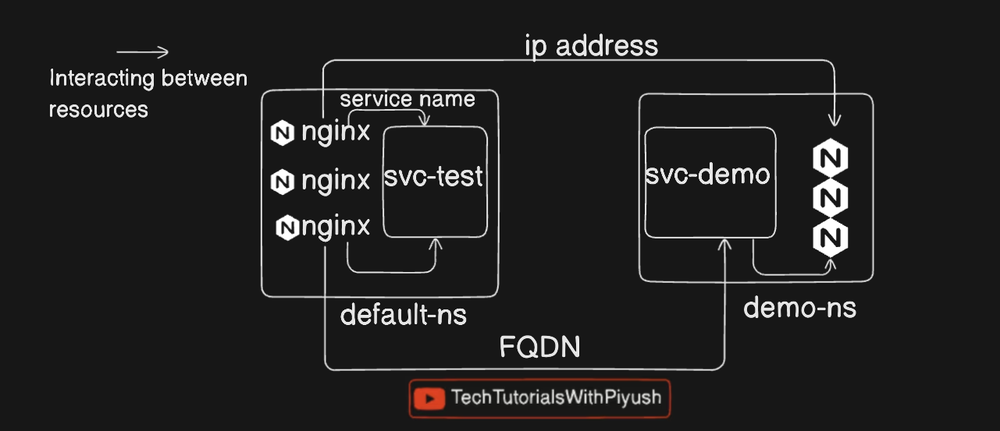

# Kubernetes — Practical Learning Notes

A structured, hands-on guide to Kubernetes, from container fundamentals and cluster architecture to workloads, networking, storage, security, administration, and troubleshooting.

This directory is part of the [Learnings](https://github.com/iamjpsonkar/Learnings) repository. Treat it as a working notebook: understand a concept, write a manifest, apply it to a cluster, inspect the result, introduce a controlled failure, and document what you learned.

> **Learning sequence:** Docker fundamentals → Kubernetes architecture → local cluster → kubectl and YAML → Pods and controllers → Services and networking → configuration and security → storage → cluster operations and troubleshooting.

## Contents

- [Learning resources](#learning-resources)
- [How to use these notes](#how-to-use-these-notes)
- [Prerequisites and lab setup](#prerequisites-and-lab-setup)
- [1. Container fundamentals](#1-container-fundamentals)
- [2. What Kubernetes solves](#2-what-kubernetes-solves)
- [3. Kubernetes architecture](#3-kubernetes-architecture)
- [4. Install a local cluster](#4-install-a-local-cluster)
- [5. kubectl fundamentals](#5-kubectl-fundamentals)
- [6. YAML and Kubernetes manifests](#6-yaml-and-kubernetes-manifests)
- [7. Pods](#7-pods)
- [8. Labels, selectors, and namespaces](#8-labels-selectors-and-namespaces)
- [9. ReplicaSets and Deployments](#9-replicasets-and-deployments)
- [10. Services and service discovery](#10-services-and-service-discovery)
- [11. Configuration and secrets](#11-configuration-and-secrets)
- [12. Workloads and scheduling](#12-workloads-and-scheduling)
- [13. Networking](#13-networking)
- [14. Storage](#14-storage)
- [15. Security and access control](#15-security-and-access-control)
- [16. Cluster administration](#16-cluster-administration)
- [17. Troubleshooting](#17-troubleshooting)
- [18. Helm, Kustomize, CRDs, and operators](#18-helm-kustomize-crds-and-operators)
- [19. Practical exercises](#19-practical-exercises)
- [Quick reference](#quick-reference)
- [Repository map](#repository-map)
- [Important notes](#important-notes)

## Learning resources

| Resource | Purpose |
|---|---|
| [Piyush Sachdeva — CKA-2024 repository](https://github.com/piyushsachdeva/CKA-2024/) | Day-wise notes, commands, YAML, hands-on assignments, and extended CKA topics |
| [40 Days of Kubernetes video playlist](https://www.youtube.com/watch?v=6_gMoe7Ik8k&list=PLl4APkPHzsUUOkOv3i62UidrLmSB8DcGC) | Main video learning sequence |
| [Official Kubernetes documentation](https://kubernetes.io/docs/) | Current concepts, APIs, installation, and administration |
| [Kubernetes concepts](https://kubernetes.io/docs/concepts/) | Workloads, networking, storage, configuration, and security |
| [kubectl reference](https://kubernetes.io/docs/reference/kubectl/) | CLI command reference |
| [Official CKA curriculum](https://github.com/cncf/curriculum) | Exam objectives and domain coverage |

The upstream course repository is named `CKA-2024`, but its README may be updated as the curriculum evolves. The original Day 1–40 videos were recorded against older Kubernetes versions. Use the updated upstream notes and official documentation to verify commands and APIs for your cluster and exam.

## How to use these notes

For each topic, follow the same loop:

1. **Understand:** Identify the problem the Kubernetes feature solves.
2. **Read:** Study the explanation and inspect the example manifest.
3. **Predict:** Explain what objects should be created and how they relate.
4. **Apply:** Run the commands against your lab cluster.
5. **Verify:** Inspect resource state, events, logs, endpoints, and application behavior.
6. **Break:** Introduce one controlled failure.
7. **Fix:** Restore the intended state and verify it again.
8. **Document:** Record commands, observations, errors, and fixes.

A successful `kubectl apply` only confirms that the API accepted an object. It does not prove that a Pod is Ready, a Service has endpoints, an application is reachable, or data is persistent.

Track the full syllabus in [ROADMAP.md](ROADMAP.md), follow [Handson.md](Handson.md) for guided practical work, and use [notes.md](notes.md) for the longer beginner guide. The previous README content is preserved in [REFERENCE-NOTES.md](REFERENCE-NOTES.md).

## Prerequisites and lab setup

### Basic prerequisites

- Basic Linux shell usage and file permissions.
- Basic networking: IP addresses, ports, DNS, HTTP, and TLS.
- Container concepts (covered below before Kubernetes).
- A machine with enough CPU and memory for a local cluster.

### Tools

| Tool | Purpose | Documentation |
|---|---|---|
| Docker or compatible runtime | Run local containers and support kind | [Docker Engine](https://docs.docker.com/engine/install/) |
| kubectl | Communicate with the Kubernetes API | [Install kubectl](https://kubernetes.io/docs/tasks/tools/) |
| kind | Create local single-node or multi-node clusters | [kind quick start](https://kind.sigs.k8s.io/docs/user/quick-start/) |
| Minikube | Run a local Kubernetes cluster | [Minikube start](https://minikube.sigs.k8s.io/docs/start/) |
| kubeadm | Build and administer clusters on Linux VMs | [kubeadm guide](https://kubernetes.io/docs/setup/production-environment/tools/kubeadm/) |
| Helm | Package and manage Kubernetes applications | [Helm installation](https://helm.sh/docs/intro/install/) |

### Choose a lab

| Environment | Recommended use |
|---|---|
| kind or Minikube | Pods, Deployments, Services, namespaces, configuration, scheduling, and application debugging |
| Multi-node kind | Node placement, affinity, taints, and multi-node behavior |
| kubeadm on Linux VMs | Cluster installation, certificates, node maintenance, upgrades, etcd backup/restore, and control-plane troubleshooting |

For most exercises here, kind is sufficient. kubeadm exercises require Linux virtual machines and direct access to the nodes.

### Create a kind cluster

Use the existing [multi-node kind configuration](kind_cluster/kind-example-config.yaml):

```bash
kind create cluster --name k8s-lab --config kind_cluster/kind-example-config.yaml
kubectl config current-context
kubectl cluster-info
kubectl get nodes -o wide
```

This creates a control-plane node and two workers. It does not publish a NodePort to your host.

For the NodePort exercise, use [services/kind.yaml](services/kind.yaml), which maps host port 30001:

```bash
kind create cluster --name k8s-nodeport --config services/kind.yaml
kubectl get nodes
```

Check for existing clusters before creating another:

```bash
kind get clusters
```

Delete only a lab cluster you no longer need:

```bash
kind delete cluster --name k8s-lab
```

Pin Kubernetes node images when reproducibility matters. Do not assume a version in an old command is still current.

---

## 1. Container fundamentals

A container packages an application and its runtime dependencies into an isolated process environment. A container image is the immutable template used to create containers.

### Containers versus virtual machines


A virtual machine includes a guest operating system on virtualized hardware. Containers share the host kernel and isolate processes using operating-system primitives. Containers are generally more lightweight, but containers and virtual machines solve different isolation and compatibility problems.

### What Docker provides

Docker provides tooling to build images and run containers. Common concepts:

- **Image:** Read-only template containing application files and metadata.
- **Container:** Running instance created from an image.
- **Registry:** Stores and distributes images.
- **Volume:** Provides persistent or shared container storage.
- **Network:** Connects containers and external systems.


Typical image and container workflow:

```bash
docker build -t hello-app:v1 .
docker images
docker run --name hello-app hello-app:v1
docker ps
docker logs hello-app
docker exec -it hello-app sh
docker stop hello-app
docker rm hello-app
```

### Why orchestration is needed

A real application may contain APIs, workers, caches, databases, and multiple replicas distributed across machines. Operators need to schedule, scale, update, connect, monitor, and recover those workloads.


Docker helps build and run containers. Kubernetes orchestrates containerized workloads across a cluster.


## 2. What Kubernetes solves

**Kubernetes is an open-source platform for managing containerized workloads and services.** You declare the state you want, and Kubernetes controllers continually work to make the actual state match that desired state.

| Problem | Kubernetes concept |
|---|---|
| A Pod disappears | Controllers create replacement Pods when required |
| An application needs more instances | Deployments and replica counts |
| Pod IP addresses change | Services provide stable endpoints |
| Applications need controlled releases | Deployments and rollout history |
| Settings differ by environment | ConfigMaps and Secrets |
| Data must outlive a Pod | Volumes, PVs, PVCs, and StorageClasses |
| Workloads need separation and policy | Namespaces, RBAC, quotas, and NetworkPolicies |
| Applications need external HTTP routing | Ingress or Gateway API with a controller |
| Resources need repeatable packaging | Helm and Kustomize |

Kubernetes does not automatically make an application highly available, secure, or backed up. Those outcomes depend on cluster topology, application design, storage, networking, and operating practices.

### Core mental model

- **Cluster:** The complete Kubernetes environment.
- **Node:** A physical or virtual machine in the cluster.
- **Pod:** The smallest deployable Kubernetes unit, containing one or more containers.
- **Deployment:** Declares desired state for a stateless application and manages ReplicaSets.
- **ReplicaSet:** Maintains a desired number of matching Pods.
- **Service:** Provides a stable endpoint for Pods selected by labels.


## 3. Kubernetes architecture

A cluster consists of a control plane and one or more worker nodes. The control plane exposes the API and manages cluster state; worker nodes run application Pods.


### Control plane components

| Component | Responsibility |
|---|---|
| `kube-apiserver` | Exposes the Kubernetes API; validates and processes requests |
| `etcd` | Consistent key-value store for Kubernetes API data |
| `kube-scheduler` | Selects a suitable node for each unscheduled Pod |
| `kube-controller-manager` | Runs controllers that reconcile observed state toward desired state |
| `cloud-controller-manager` | Optional integration with cloud-provider APIs |

### Worker node components

| Component | Responsibility |
|---|---|
| `kubelet` | Ensures Pods assigned to the node are running and healthy |
| Container runtime | Pulls images and starts/stops containers through CRI |
| `kube-proxy` | Commonly configures Service traffic forwarding; some network implementations replace it |

### What happens when you create a Deployment?

1. `kubectl` sends the request to the API server.
2. The API server authenticates, authorizes, validates, and stores the desired object.
3. The Deployment controller creates a ReplicaSet.
4. The ReplicaSet controller creates Pods.
5. The scheduler assigns each unscheduled Pod to a suitable node.
6. The kubelet asks the container runtime to prepare and start containers.
7. Node and Pod status is reported back through the API.

The scheduler selects the node; it does not start containers itself. The kubelet and container runtime handle node-level execution.

### Component diagrams from the original notes


## 4. Install a local cluster

### Install kubectl

Follow the current [official installation instructions](https://kubernetes.io/docs/tasks/tools/). Do not install kubectl using a copied binary URL unless it matches your operating system and CPU architecture.

Verify:

```bash
kubectl version --client
kubectl config get-contexts
```

### Install kind

Follow the [kind installation guide](https://kind.sigs.k8s.io/docs/user/quick-start/#installation). Verify:

```bash
kind version
docker version
```

kind requires a supported container runtime. The runtime must be installed and running before creating a cluster.

### Create and inspect a cluster

```bash
kind create cluster --name k8s-lab --config kind_cluster/kind-example-config.yaml
kind get clusters
kubectl cluster-info --context kind-k8s-lab
kubectl get nodes -o wide
kubectl get pods -A
```

Example output varies by machine and Kubernetes version. Verify the actual cluster instead of relying on copied output.

### Multi-node cluster

The supplied kind configuration has one control-plane node and two worker nodes:

```bash
cat kind_cluster/kind-example-config.yaml
kind create cluster --name k8s-multi --config kind_cluster/kind-example-config.yaml
kubectl get nodes -o wide
```

### Context switching

```bash
kubectl config get-contexts
kubectl config current-context
kubectl config use-context kind-k8s-multi
```

Always confirm the active context before applying or deleting resources.

## 5. kubectl fundamentals

`kubectl` is the command-line client for the Kubernetes API.

### Inspect the API and cluster

```bash
kubectl cluster-info
kubectl get nodes
kubectl get namespaces
kubectl api-resources
kubectl api-versions
kubectl explain pod
kubectl explain pod.spec.containers
```

### List resources

```bash
kubectl get pods
kubectl get pods -A
kubectl get pods -o wide
kubectl get deployments
kubectl get replicasets
kubectl get services
kubectl get all -n default
```

Note: `kubectl get all` is a convenience grouping, not literally every resource type in the API.

### Inspect an object

```bash
kubectl describe pod <pod-name>
kubectl get pod <pod-name> -o yaml
kubectl get pod <pod-name> -o json
kubectl get events --sort-by=.metadata.creationTimestamp
```

### Imperative and declarative workflows

Imperative creation:

```bash
kubectl run nginx-pod --image=nginx:1.27
kubectl create deployment nginx --image=nginx:1.27
```

Generate a manifest without creating the resource:

```bash
kubectl run nginx-pod --image=nginx:1.27 --dry-run=client -o yaml
kubectl create deployment nginx --image=nginx:1.27 --dry-run=client -o yaml
```

Declarative workflow:

```bash
kubectl apply -f pod.yaml
kubectl diff -f pod.yaml
kubectl delete -f pod.yaml
```

Use declarative manifests for repeatable learning exercises. Use imperative commands to learn the CLI and quickly generate templates.

## 6. YAML and Kubernetes manifests

YAML is a human-readable data serialization format commonly used for Kubernetes manifests. File extensions `.yaml` and `.yml` are both used.

### Basic syntax

```yaml
name: nginx
version: "1.0"
enabled: true

ports:
  - 80
  - 443

application:
  name: web
  replicas: 3
```

Important rules:

- Use spaces, not tabs, for indentation.
- Indentation defines nested objects and lists.
- YAML is case-sensitive.
- Quote strings that could be interpreted as booleans, numbers, or special values.
- Use `#` for comments.
- Use `|` for literal multiline strings and `>` for folded text.

### Kubernetes object structure

Most Kubernetes manifests have four top-level fields:

```yaml
apiVersion: v1
kind: Pod
metadata:
  name: nginx
  labels:
    app: nginx
spec:
  containers:
    - name: nginx
      image: nginx:1.27
```

| Field | Meaning |
|---|---|
| `apiVersion` | API group/version that defines the resource |
| `kind` | Resource type |
| `metadata` | Name, namespace, labels, annotations, and other metadata |
| `spec` | Desired configuration for the resource |

Some objects expose a `status` section, which is normally populated by Kubernetes rather than specified in hand-written desired-state manifests.

### Useful YAML tools

- [YAML specification](https://yaml.org/spec/)
- [yamllint](https://yamllint.com/)
- [Kubernetes object management](https://kubernetes.io/docs/concepts/overview/working-with-objects/)

## 7. Pods

A Pod is the smallest deployable unit in Kubernetes. A Pod may contain one or more containers that share a network namespace and can share mounted volumes.


### Create a Pod imperatively

```bash
kubectl run nginx-pod --image=nginx:1.27
kubectl get pods -o wide
kubectl describe pod nginx-pod
kubectl logs nginx-pod
kubectl exec -it nginx-pod -- sh
```

### Create a Pod declaratively

Example `pod.yaml`:

```yaml
apiVersion: v1
kind: Pod
metadata:
  name: nginx-pod
  labels:
    app: nginx
spec:
  containers:
    - name: nginx
      image: nginx:1.27
      ports:
        - name: http
          containerPort: 80
```

Apply and inspect:

```bash
kubectl apply -f pod.yaml
kubectl get pod nginx-pod
kubectl describe pod nginx-pod
kubectl get pod nginx-pod -o yaml
```

### Pod lifecycle and debugging

Common states include Pending, Running, Succeeded, Failed, and Unknown. Container waiting reasons include ImagePullBackOff and CrashLoopBackOff.

```bash
kubectl get pod nginx-pod -w
kubectl describe pod nginx-pod
kubectl logs nginx-pod
kubectl logs nginx-pod --previous
kubectl delete pod nginx-pod
```

A Pod created directly is not automatically recreated after deletion. Use a controller such as a Deployment when you need replicas and self-healing.

### Multi-container Pods

Containers in the same Pod share the Pod IP and can communicate over localhost. They may share volumes. Common patterns include sidecars and init containers. Keep tightly coupled containers together; do not use a multi-container Pod merely because two applications belong to one product.

## 8. Labels, selectors, and namespaces

Labels are key-value metadata used to organize and select objects. Selectors allow controllers and Services to identify the Pods they manage or route traffic to.

```bash
kubectl get pods --show-labels
kubectl get pods -l app=nginx
kubectl label pod nginx-pod environment=dev
kubectl label pod nginx-pod environment-
```

### Namespaces

Namespaces provide logical grouping and naming scope for namespaced resources. They are useful for teams, environments, and application boundaries.



```bash
kubectl get namespaces
kubectl create namespace demo
kubectl get pods -n demo
kubectl get pods -A
kubectl config set-context --current --namespace=demo
```

The current namespace setting changes the default for that context. You can always specify `-n <namespace>` explicitly.

Important: namespaces do not provide network isolation by themselves. Use NetworkPolicies and a compatible network plugin when network restrictions are required. Nodes, PersistentVolumes, StorageClasses, ClusterRoles, and namespaces themselves are cluster-scoped.

## 9. ReplicaSets and Deployments

### ReplicationController

ReplicationController is a legacy controller that maintains a configured number of Pods. It supports equality-based selectors. It is useful to understand historically, but new application workloads should generally use Deployments.

### ReplicaSet

A ReplicaSet maintains the desired number of matching Pods. It supports set-based selectors through `matchExpressions`.


### Deployment

A Deployment manages ReplicaSets and provides declarative rollout and rollback for stateless applications.


Example:

```yaml
apiVersion: apps/v1
kind: Deployment
metadata:
  name: nginx-deploy
  labels:
    app: nginx
spec:
  replicas: 3
  selector:
    matchLabels:
      app: nginx
  template:
    metadata:
      labels:
        app: nginx
    spec:
      containers:
        - name: nginx
          image: nginx:1.27
          ports:
            - name: http
              containerPort: 80
```

Apply and verify:

```bash
kubectl apply -f deployment/deploy.yaml
kubectl get deployments,replicasets,pods
kubectl rollout status deployment/nginx-deploy
```

Scale and update:

```bash
kubectl scale deployment/nginx-deploy --replicas=5
kubectl set image deployment/nginx-deploy nginx=nginx:1.28
kubectl rollout status deployment/nginx-deploy
kubectl rollout history deployment/nginx-deploy
kubectl rollout undo deployment/nginx-deploy
```

A Deployment selector must match the labels in its Pod template. Selectors should be unique to the workload; overlapping controllers can unintentionally manage the same Pods.

## 10. Services and service discovery

Pods are replaceable and their IP addresses can change. A Service provides a stable virtual endpoint and selects backend Pods using labels.


### Service types

| Type | Purpose |
|---|---|
| ClusterIP | Internal virtual IP accessible within the cluster; default type |
| NodePort | Exposes a port on each node, typically in the configured NodePort range |
| LoadBalancer | Requests an external load balancer from a supported platform/provider |
| ExternalName | Returns a DNS CNAME for an external hostname; it does not proxy traffic |


The provided Service manifests select Pods labelled `app: nginx-deploy`. The matching Deployment is [services/deploy.yaml](services/deploy.yaml).

Apply examples:

```bash
kubectl apply -f services/deploy.yaml
kubectl apply -f services/clusterip.yaml
kubectl get services
kubectl get endpointslices
kubectl describe service cluster-svc
```

For NodePort, create the kind cluster with [services/kind.yaml](services/kind.yaml) before applying `services/nodeport.yaml`:

```bash
kubectl apply -f services/nodeport.yaml
kubectl get service nodeport-svc
curl http://localhost:30001
```

For LoadBalancer, a local cluster usually needs an additional load-balancer implementation. Without one, the external address may remain Pending. ExternalName is a DNS alias; it does not create endpoints or proxy an HTTP connection.

### Service discovery

Inside the same namespace, a Service can normally be reached by its short name. From another namespace, use `<service>.<namespace>` or the full DNS name:

```text
<service>.<namespace>.svc.cluster.local
```

Troubleshoot selectors and endpoints:

```bash
kubectl get pods --show-labels
kubectl get service cluster-svc -o yaml
kubectl get endpointslices -l kubernetes.io/service-name=cluster-svc
kubectl get pods -n kube-system
```

A Service with no ready endpoints commonly indicates a selector mismatch or no Ready backend Pods.

## 11. Configuration and secrets

### ConfigMaps

ConfigMaps store non-sensitive configuration. Values can be exposed as environment variables or mounted as files.

### Secrets

Secrets store sensitive values such as tokens and passwords. Base64 in a Secret manifest is encoding, not encryption. Do not commit real passwords, API tokens, kubeconfig files, or private keys to Git. Use a secret-management solution and configure encryption at rest and access controls where appropriate.

Example workflow:

```bash
kubectl create configmap app-config --from-literal=LOG_LEVEL=info
kubectl create secret generic app-secret --from-literal=API_TOKEN=replace-me
kubectl get configmaps,secrets
kubectl describe configmap app-config
```

Example manifests and a configured Pod are available in [configuration/](configuration/).

## 12. Workloads and scheduling

Kubernetes provides several controllers for different workload patterns.

| Resource | Typical purpose |
|---|---|
| Deployment | Stateless replicated applications |
| StatefulSet | Stateful applications needing stable identity and storage association |
| DaemonSet | Run a Pod on every eligible node |
| Job | Run a task to completion |
| CronJob | Create Jobs on a schedule |
| Static Pod | Pod managed by kubelet from a node-local manifest |

### Scheduling concepts

- **Requests and limits:** Requests influence scheduling; limits constrain resource use.
- **Node selector:** Simple node-label matching.
- **Node affinity:** Expresses required or preferred node placement rules.
- **Pod affinity/anti-affinity:** Places Pods relative to other Pods.
- **Taints and tolerations:** Repel Pods unless they tolerate the taint; a toleration does not force placement.
- **PriorityClass:** Assigns relative scheduling priority and can enable preemption.

See examples in [workloads/](workloads/) and [scheduling/](scheduling/).

```bash
kubectl get pods -o wide
kubectl describe pod <pod-name>
kubectl get jobs,cronjobs,daemonsets,statefulsets
kubectl top nodes
kubectl top pods
```

Metrics commands require a compatible metrics pipeline such as metrics-server.

## 13. Networking

Kubernetes networking involves Pod-to-Pod connectivity, Services, DNS, network plugins, and external traffic routing.

### Main concepts

- **CNI:** Container Network Interface plugin configures Pod networking.
- **CoreDNS:** Provides cluster DNS service discovery.
- **NetworkPolicy:** Defines allowed Pod ingress and egress traffic, when enforced by a compatible CNI.
- **Ingress:** HTTP/HTTPS routing rules that require an Ingress controller.
- **Gateway API:** A newer, role-oriented set of routing APIs including GatewayClass, Gateway, and HTTPRoute. It requires a compatible controller and CRDs.

NetworkPolicies are not enforced by every network plugin. Creating a NetworkPolicy object on a cluster whose CNI does not implement it may have no effect. Ingress objects also do not create a data plane on their own.

See [networking/](networking/) for starter manifests. For deeper topics, follow the relevant days in the [CKA course repository](https://github.com/piyushsachdeva/CKA-2024/).

## 14. Storage

Containers have an ephemeral writable layer. Kubernetes provides volume abstractions to supply data to Pods and keep data independent of a particular container instance.

| Resource | Purpose |
|---|---|
| emptyDir | Temporary volume whose lifetime is tied to the Pod |
| hostPath | Mounts a path from the node filesystem; use carefully |
| PersistentVolume (PV) | Represents provisioned storage in the cluster |
| PersistentVolumeClaim (PVC) | A workload's request for storage |
| StorageClass | Defines a storage class and provisioner for dynamic provisioning |

Access modes, volume modes, reclaim policies, binding modes, and CSI drivers affect how storage is provisioned and mounted.

See [storage/](storage/) and the StatefulSet example in [workloads/](workloads/). PVC examples may require a default StorageClass or a compatible storage provisioner. Inspect first:

```bash
kubectl get storageclass
kubectl get pv,pvc -A
kubectl describe pvc <claim-name>
```

## 15. Security and access control

Kubernetes security involves authentication, authorization, admission, workload security, network controls, and protection of secrets.

### RBAC

- **Role:** Defines permissions within a namespace.
- **RoleBinding:** Grants a Role or ClusterRole to subjects in a namespace.
- **ClusterRole:** Defines cluster-wide or reusable permissions.
- **ClusterRoleBinding:** Grants a ClusterRole across the cluster.

```bash
kubectl auth can-i list pods -n demo
kubectl auth can-i create deployments -n demo
kubectl get serviceaccounts,roles,rolebindings -n demo
```

Examples live in [security/](security/).

### Pod security

SecurityContext can define the user/group ID, capabilities, privilege escalation, filesystem behavior, and seccomp settings. Pod Security Admission can enforce the Baseline or Restricted standards at namespace level.

Never use privileged mode or broad cluster-admin permissions just to make an exercise work. Understand the permission being granted.

## 16. Cluster administration

Cluster administration requires access to the Linux nodes and a cluster built with an appropriate tool such as kubeadm.

Important tasks:

- kubeadm installation and cluster lifecycle.
- Node maintenance with `cordon`, `drain`, and `uncordon`.
- Kubernetes minor-version upgrades.
- etcd snapshots and tested recovery.
- Certificate inspection and renewal.
- Control-plane component health.
- Container runtime and kubelet troubleshooting.
- Highly available control-plane architecture.

See [operations/README.md](operations/README.md) and [operations/EXTENDED-TOPICS.md](operations/EXTENDED-TOPICS.md). Back up etcd before risky changes, store snapshots securely, and test restores in a controlled environment.

## 17. Troubleshooting

Troubleshoot methodically: identify the affected resource, inspect its state and events, check its owner/controller, and then investigate scheduling, configuration, storage, networking, and node-level components.

### First-response commands

```bash
kubectl config current-context
kubectl get nodes -o wide
kubectl get pods -A -o wide
kubectl get events -A --sort-by=.metadata.creationTimestamp
kubectl get deployments,replicasets,statefulsets,daemonsets -A
```

### Common symptoms

| Symptom | Possible causes | First checks |
|---|---|---|
| Pending | Unsatisfied requests, taints, affinity, unbound PVC | `describe pod`, events, PVC |
| ImagePullBackOff | Wrong image/tag, registry auth, network/DNS | Pod events and image reference |
| CrashLoopBackOff | Process exits, bad config, failing probe | `logs`, `logs --previous`, describe |
| OOMKilled | Memory limit too low or application memory issue | Last state, resource settings, metrics |
| No Service endpoints | Selector mismatch or no Ready Pods | Pod labels and EndpointSlices |
| DNS failure | CoreDNS, network plugin, DNS policy, bad name | `nslookup`, CoreDNS Pods/logs |
| PVC Pending | No suitable PV or dynamic provisioner | PVC events, StorageClasses |

Full guide and practice drills: [troubleshooting/README.md](troubleshooting/README.md).

## 18. Helm, Kustomize, CRDs, and operators

### Helm

Helm packages Kubernetes manifests into Charts and manages installed releases. This repository includes a starter chart in [helm/nginx/](helm/nginx/).

```bash
helm lint helm/nginx
helm template demo-web helm/nginx
helm install demo-web helm/nginx --namespace demo --create-namespace
helm list -n demo
helm upgrade demo-web helm/nginx --set replicaCount=3 -n demo
helm history demo-web -n demo
helm rollback demo-web 1 -n demo
helm uninstall demo-web -n demo
```

### Kustomize

Kustomize applies environment-specific changes through bases and overlays without requiring templates.

```bash
kubectl kustomize kustomize/overlays/dev
kubectl diff -k kustomize/overlays/dev
kubectl apply -k kustomize/overlays/dev
kubectl delete -k kustomize/overlays/dev
```

### CRDs and operators

A CustomResourceDefinition (CRD) extends the Kubernetes API with a new resource type. A controller or Operator adds behavior by reconciling those custom resources.

The [custom-resources/](custom-resources/) directory contains a learning CRD and custom resource. A CRD by itself defines and validates an API object; it does not implement application logic.

## 19. Practical exercises

Suggested sequence:

1. Create a local kind cluster and explain each node.
2. Deploy an NGINX Pod imperatively and declaratively.
3. Replace the Pod with a Deployment and observe the ReplicaSet.
4. Delete one Pod and watch the controller replace it.
5. Expose the Deployment through a ClusterIP Service.
6. Break the Service selector and diagnose empty endpoints.
7. Expose the workload through NodePort in the kind cluster configured for host port mapping.
8. Add ConfigMaps and Secrets; inspect environment variables and mounted files.
9. Schedule a Pod using labels, affinity, and tolerations.
10. Restrict traffic with NetworkPolicies on a compatible CNI.
11. Mount a PVC and verify that data survives Pod replacement.
12. Create an RBAC Role and prove allowed and denied operations with `kubectl auth can-i`.
13. Deploy the sample Helm Chart and render the Kustomize overlay.
14. Work through the troubleshooting drills with a time limit.

Use [Handson.md](Handson.md) for the guided commands and cleanup instructions. Use [ROADMAP.md](ROADMAP.md) as the completion tracker.

## Quick reference

### Cluster and context

```bash
kubectl cluster-info
kubectl get nodes -o wide
kubectl config get-contexts
kubectl config current-context
kubectl config use-context <context>
```

### Inspect resources

```bash
kubectl get pods -A -o wide
kubectl get events -A --sort-by=.metadata.creationTimestamp
kubectl get <resource> <name> -o yaml
kubectl describe <resource> <name>
kubectl explain <resource>.spec
```

### Apply and delete manifests

```bash
kubectl apply -f manifest.yaml
kubectl diff -f manifest.yaml
kubectl delete -f manifest.yaml
```

### Deployments

```bash
kubectl rollout status deployment/<name>
kubectl rollout history deployment/<name>
kubectl rollout undo deployment/<name>
kubectl scale deployment/<name> --replicas=3
kubectl set image deployment/<name> <container>=<image>:<tag>
```

### Debug containers and Services

```bash
kubectl logs <pod>
kubectl logs <pod> --previous
kubectl exec -it <pod> -- sh
kubectl get endpointslices
kubectl get pods --show-labels
```

### Node maintenance

```bash
kubectl cordon <node>
kubectl drain <node> --ignore-daemonsets
kubectl uncordon <node>
```

Always confirm your cluster context and namespace before running mutating commands. Replace placeholders before executing commands.

## Repository map

| Path | Description |
|---|---|
| [README.md](README.md) | Main guide and concept explanations |
| [ROADMAP.md](ROADMAP.md) | Full CKA-oriented topic checklist |
| [Handson.md](Handson.md) | Guided practical exercises |
| [notes.md](notes.md) | Long-form beginner learning guide |
| [REFERENCE-NOTES.md](REFERENCE-NOTES.md) | Previous README content preserved for reference |
| [download-assets.sh](download-assets.sh) | Download remote Markdown images into `assets/` |
| [assets/](assets/) | Locally stored diagrams and images |
| [deployment/](deployment/) | Deployment manifest |
| [kubectl_pod_creation/](kubectl_pod_creation/) | Pod manifest |
| [replication/](replication/) | ReplicationController and ReplicaSet manifests |
| [namespaces/](namespaces/) | Namespace manifest |
| [kind_cluster/](kind_cluster/) | Multi-node kind configuration |
| [services/](services/) | Service manifests and NodePort kind configuration |
| [configuration/](configuration/) | ConfigMap and Secret examples |
| [workloads/](workloads/) | Jobs, CronJobs, DaemonSets, StatefulSets |
| [scheduling/](scheduling/) | Scheduling and resource-control examples |
| [security/](security/) | ServiceAccount, RBAC, and Pod Security examples |
| [networking/](networking/) | NetworkPolicy and Ingress examples |
| [storage/](storage/) | PVC examples |
| [operations/](operations/) | Cluster administration and extended topics |
| [troubleshooting/](troubleshooting/) | Troubleshooting playbook |
| [helm/](helm/) | Starter Helm chart |
| [kustomize/](kustomize/) | Base resources and development overlay |
| [custom-resources/](custom-resources/) | CRD and custom-resource examples |

## Important notes

- Kubernetes APIs and command behavior can change between versions. Check the API version supported by your cluster.
- A container port declaration does not publish a Service or open a host port by itself.
- A NodePort in kind needs an appropriate `extraPortMappings` configuration to reach it through localhost.
- A LoadBalancer Service needs a cloud integration or local load-balancer implementation.
- NetworkPolicies require a CNI implementation that enforces them.
- Ingress requires an installed Ingress controller. Gateway API requires CRDs and a compatible controller.
- PVC and StatefulSet examples require a suitable StorageClass or pre-provisioned storage.
- Metrics commands require a metrics pipeline such as metrics-server.
- Base64 is not encryption. Never commit real credentials or private keys.
- Do not run cluster upgrade, etcd restore, or node maintenance commands on a production cluster without a tested plan and backups.

---

**Keep learning by building, testing, troubleshooting, and documenting.**
