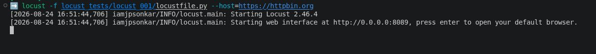
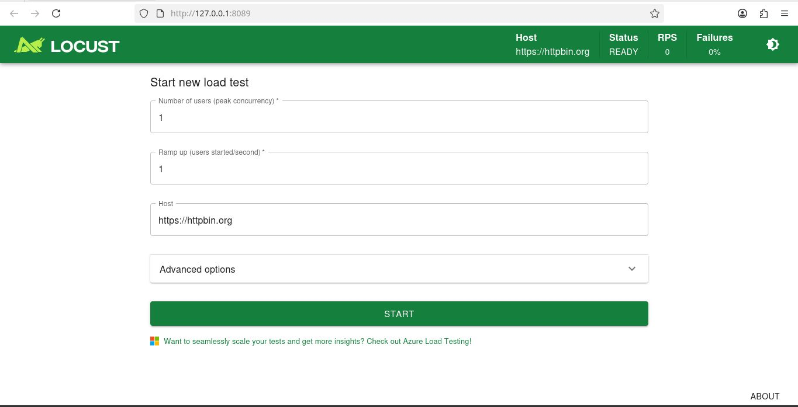
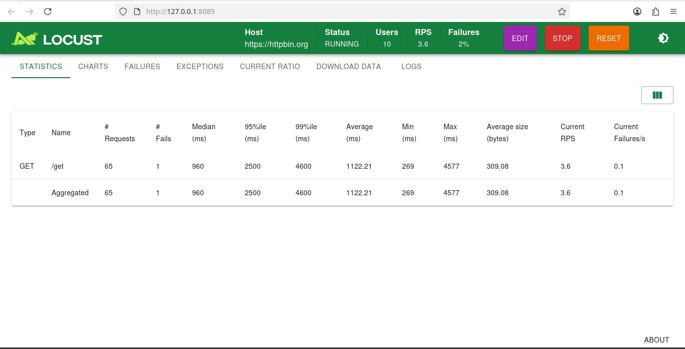
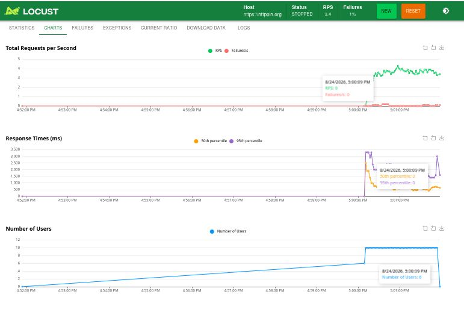
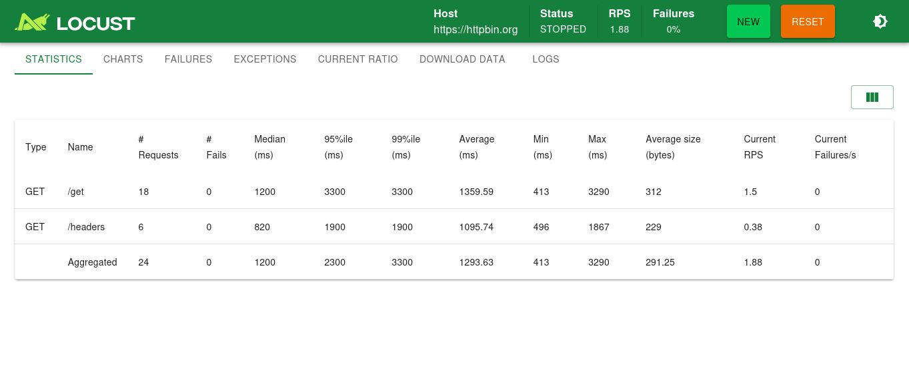

# Installing and Running Locust

## Prerequisites

- Windows, macOS, or Linux
- A Python version supported by the Locust release being installed
- A terminal and permission to create a virtual environment

The environment used for this repository has Locust 2.46.4, which requires
Python 3.11 or later.

## Installation

Create a virtual environment so the project dependencies remain isolated:

```sh
python3 -m venv .locust_venv
source .locust_venv/bin/activate
python -m pip install --upgrade pip
python -m pip install -r requirements.txt
```

On Windows PowerShell, activate the environment with:

```powershell
.locust_venv\Scripts\Activate.ps1
```

## Verification

```sh
locust --version
```

The command should print the Locust and Python versions. If `locust` is not
found, confirm that the virtual environment is active.

## First Locust test

Create `locust_tests/locust_001/locustfile.py`:

```python
from locust import HttpUser, between, task


class WebsiteUser(HttpUser):
    wait_time = between(1, 3)

    @task
    def get_data(self):
        self.client.get("/get")
```

This defines one type of simulated user. After each completed task, the user
waits for a random duration between one and three seconds.

Start Locust against httpbin:

```sh
locust -f locust_tests/locust_001/locustfile.py \
  --host=https://httpbin.org
```



Locust starts its web interface at <http://localhost:8089>. Open that address in
a browser, or press Enter in a supported terminal to open it.



For a small learning run, enter:

```text
Number of users: 10
Ramp up (users started/second): 2
```

Select **Start** to begin. Ten users are simulated, and Locust starts two users
per second until all ten are running.

## Understanding the web interface

### Statistics



The Statistics tab summarizes requests:

- **Type:** HTTP method, such as GET or POST.
- **Name:** Request path or custom statistics name.
- **Requests:** Total number of completed requests.
- **Fails:** Number and percentage of failed requests.
- **Median:** Median response time.
- **95%ile / 99%ile:** Response-time percentile values.
- **Average / Min / Max:** Response-time summary in milliseconds.
- **Average size:** Average response payload size in bytes.
- **Current RPS:** Current requests per second.
- **Current Failures/s:** Current failures per second.

### Charts



The Charts tab displays request rate, response-time percentiles, failures, and
active user count over time.

### Other tabs

- **Failures:** Groups failed requests by method, name, and error.
- **Exceptions:** Shows exceptions raised by task code.
- **Current ratio:** Shows the current distribution of user classes and tasks.
- **Download data:** Exports statistics and failure data.
- **Logs:** Displays Locust log messages.

## Multiple tasks and weights

Create `locust_tests/locust_002/locustfile.py`:

```python
from locust import HttpUser, between, task


class WebsiteUser(HttpUser):
    wait_time = between(1, 3)

    @task(3)
    def get_data(self):
        self.client.get("/get")

    @task(1)
    def get_headers(self):
        self.client.get("/headers")
```

The `3:1` task-weight ratio means `get_data` is selected about three times as
often as `get_headers`. Selection remains random, so a short run may not produce
the exact ratio.

Run the example:

```sh
locust -f locust_tests/locust_002/locustfile.py \
  --host=https://httpbin.org
```



## Headless mode

Headless mode starts a test without the web interface. This is useful for
repeatable command-line and CI runs:

```sh
locust -f locust_tests/locust_002/locustfile.py \
  --host=https://httpbin.org \
  --headless \
  --users=10 \
  --spawn-rate=2 \
  --run-time=1m \
  --html=report.html
```

The command runs for one minute and writes an HTML report to `report.html`.
Locust returns a nonzero exit code when requests fail.

Only test a target you own or are authorized to test. Keep user counts low when
using a public demonstration service.

See the official [Locust installation guide](https://docs.locust.io/en/stable/installation.html)
and [headless-mode guide](https://docs.locust.io/en/stable/running-without-web-ui.html)
for more options.
